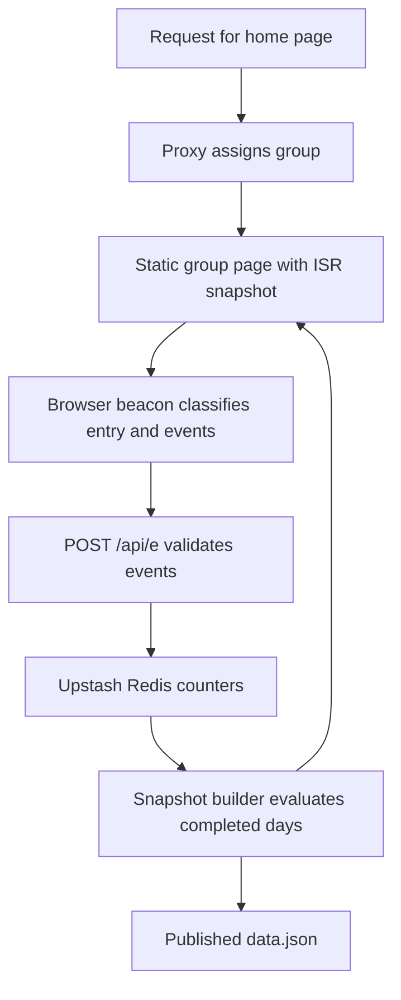

# Architecture

The site uses the Next.js App Router, with static pages and interval regeneration for the experiment views. The current home page is a scaffold with a beacon and an empty featured-card region; the case-study pages and finished live-test page are still to come. Sources: [package.json](../package.json), [Next configuration](../next.config.ts) and [home page](../src/app/v/[arm]/page.tsx).

## Figure kit

`@/components/kit` exports server-safe components, including `Figure`, `ChartFrame`, `Fact` and `DataTable`. `@/components/kit/client` exports controls, the error boundary, lazy loading and the URL-state hook. Neither entry file has a client directive; individual client modules do. `Figure` uses the client error boundary around its chart. This keeps a static component import from pulling in the controls. Sources: [server entry](../src/components/kit/index.ts), [client entry](../src/components/kit/client.ts) and [Figure](../src/components/kit/Figure.tsx).

A chart Figure shares a title, control row, result, provenance badge and table fallback. Controls use namespaced URL parameters and Reset restores that Figure's preset. Live rendering resolves phase, data availability and freshness into an explicit state. Sources: [Figure](../src/components/kit/Figure.tsx), [URL hook](../src/components/kit/useFigureParams.ts), [state logic](../src/lib/figure/states.ts) and [provenance badge](../src/components/kit/ProvenanceBadge.tsx).

## Facts and truth checks

[sources.lock.json](../sources.lock.json) pins each public export's repository, commit, path, schema and checksum. [The sync script](../scripts/sync-sources.ts) vendors those exports under `data/sources`, validates them and combines them with [profile data](../data/facts/profile.json) to generate [typed facts](../src/lib/facts/facts.generated.ts). Its `--check` mode verifies the committed files without network access; `--verify-remote` checks the pinned exports on GitHub. [Fact](../src/components/kit/Fact.tsx) renders a checked value with a `data-fact` marker; [Derived](../src/components/kit/Derived.tsx) marks computed, simulated, live or build values with references.

[The truth audit](../scripts/truth-audit.ts) parses built HTML, including accessible labels and descriptive metadata. It checks untraced numerals, unknown facts, invalid derived references and prohibited wording, with explicit [allowances](../scripts/truth-audit.allow.ts). CI requires the confidential-term check to be configured; a local run without that configuration prints a notice and skips that part. The [CI workflow](../.github/workflows/ci.yml) runs the audit after the production build.

## Design system

[Tokens](../src/styles/tokens.css) define the site's colour, typography, spacing and motion vocabulary, documented in the [token guide](design/tokens.md). [Global styles](../src/app/globals.css) consume them. [Design lint](../scripts/design-lint.ts) checks source styles and content, and optionally compiled CSS, for rules such as arbitrary colours, shadows, unsupported motion and decorative content characters. The source pass is part of `npm run check`; CI also runs the compiled-CSS pass after building, as defined in [package.json](../package.json) and [CI](../.github/workflows/ci.yml).

## A visit through the experiment

[The proxy](../src/proxy.ts) rewrites `/` to `/v/a` or `/v/b` using a fresh, equal-probability draw, without a stored visitor assignment. [Assignment logic](../src/lib/experiment/assign.ts) sends known bots to A and supports forced demo groups. Ordinary direct requests to `/v/*` resolve to a missing group; revalidation requests bypass that rule. The [group pages](../src/app/v/[arm]/page.tsx) are generated statically and regenerate every five minutes. They render the beacon before the featured-card region.

[The beacon component](../src/components/experiment/ExperimentBeacon.tsx) reads navigation signals, honours Global Privacy Control and Do Not Track by sending nothing, and records exposure, engagement and relevant clicks. [Entry classification](../src/lib/experiment/entry.ts) excludes reloads, internal navigation, repeated views in the same document, prerendering and restored pages. [The sender](../src/lib/experiment/beacon.ts) waits for entry confirmation before sending later events and flushes outstanding events when the page is left or hidden.

[POST /api/e](../src/app/api/e/route.ts) delegates to [the handler](../src/lib/experiment/handler.ts) for request validation, exclusions, rate limits and ordered event handling. [Store access](../src/lib/experiment/access.ts) permits production writes and a development-only loopback fake, never preview writes. [The Redis store](../src/lib/experiment/store.ts) uses expiring per-view event claims for idempotency and aggregate counters by group and Berlin day; later events are attributed to their entry's day. The [pre-registration](experiment/prereg.md) defines the metrics, exclusions and limits.

## Flags, snapshots and publication

[Edge Config flags](../src/lib/experiment/flags.ts) provide a pause switch and a calibration-failure note. Phase changes require configuration changes and redeployment. Malformed flags stop counting; a flag read error in the event route is logged while counting continues. Sources: [flags](../src/lib/experiment/flags.ts), [handler](../src/lib/experiment/handler.ts) and [experiment configuration](../src/experiment.config.ts).

[The pure snapshot builder](../src/lib/experiment/snapshot.ts) evaluates completed Berlin days, sample ratio mismatch, confidence sequences, calibration and decision rules. It holds analysis on data faults, excludes ceiling days from looks and blinds results until enough data exists. [The live-data reader](../src/lib/experiment/live.ts) joins counters and flags, provides page states and schedules a [closing check](../src/lib/experiment/close.ts). Before the production start it reports that nothing is counted. Build-time read failures produce an unavailable placeholder; runtime read failures throw so ISR can retain the last successful page.

[The published data route](../src/app/experiment/data.json/route.ts) regenerates on the same interval as the group pages. [Its serializer](../src/lib/experiment/public-data.ts) applies blinding and includes pre-registration and commit metadata. A successful beacon can also emit an immediate `experiment:counted` browser event; this does not regenerate the shared snapshot. Sources: [beacon component](../src/components/experiment/ExperimentBeacon.tsx), [pre-registration](experiment/prereg.md) and [deployed checks](experiment/deployed-checks.md).

## CI and deployment

[CI](../.github/workflows/ci.yml) runs these jobs on pull requests and pushes to main, every one on GitHub's hosted runner (`ubuntu-24.04`):

| Job | Checks |
|---|---|
| `static` | Types, ESLint, Stylelint, the PDF tools (python3 and pdftotext, proven on a synthetic PDF) and unit tests with statistics coverage. |
| `stats-ref` | Regenerates scipy and statsmodels references and compares them numerically with committed values. |
| `sources-remote` | Verifies pinned source exports against GitHub. |
| `build` | Production build, absence of development showcase routes, design lint and truth audit (its deny-list comes from a secret, so on a pull request from a fork that part is skipped with a notice and runs on the push to main). |
| `e2e-shard` | Playwright in its pinned container, in four parallel shards (`--shard=n/4`), including visual checks and controlled baseline updates. Each shard uploads a blob report and, while the `update-baselines` label is on, the baselines it regenerated. |
| `e2e` | The required "End-to-end tests" check: merges the shards' blob reports into the one JSON report the deployment reads, lays the regenerated baselines over the committed ones as one `visual-baselines` artifact, and fails unless every shard passed. |
| `lhci` | Lighthouse against the production build, with the slow-4G network and CPU profile applied for real. |
| `lhci-gate` | One Lighthouse result per commit: passes when Lighthouse passed in this run, or in an earlier run of the same pull request commit; fails when it was not measured or failed. |
| `links` | Lychee against the locally served build. |
| `cv-pdf` | Records the checked-out commit, its tree and the hashes of the CV checker, its claim manifest and the CV PDF; passes while no PDF is in the tree, and fails on a PDF until its check is active. |
| `build-isolation` | Runs the deploy's build wrapper with the real Vercel CLI on a synthetic pulled environment and fails unless the store's write credentials (`KV_REST_API_TOKEN`, `KV_URL`, `REDIS_URL`) are absent from every process of the build. |

The workflows are written for a public repository. CI uses `pull_request`, never `pull_request_target`, so a fork's pull request runs its own code with a read-only token and no secrets. The token may only read the contents (the deployment adds `actions: read` to fetch the CI run's reports), every action is pinned to a full commit SHA, and the only secret CI uses is the truth audit's deny-list, which is never printed and fails closed when missing outside a fork's pull request.

[The deployment workflow](../.github/workflows/deploy.yml) follows successful CI pushes to main from this repository. It checks out the tested commit, gathers test reports into [build metadata](../scripts/build-meta.ts), builds with the Vercel environment minus the store's write credentials, `KV_REST_API_TOKEN`, `KV_URL` and `REDIS_URL` (proven absent from inside the build), checks that showcase routes are absent and deploys prebuilt output. The launch setting selects preview or production; before launch, additional gates check that Vercel can create a preview and verify the resulting target. The [deployed checks guide](experiment/deployed-checks.md) describes the separate preview and launch verification.
